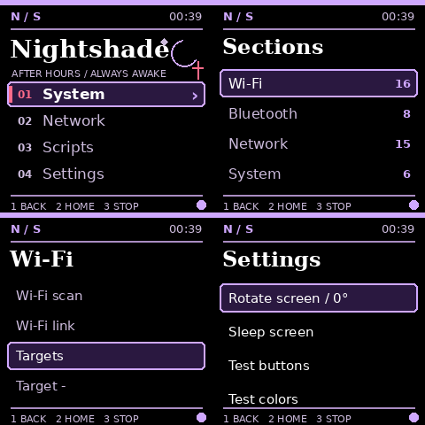

# Nightshade

Source: [github.com/darkLabz001/nightshade](https://github.com/darkLabz001/nightshade)

An independent handheld interface for your Raspberry Pi Zero 2 W, with an emo / gothic dark theme: ink black, dusty violet, crimson, crescent motifs and serif titles. Tested on the Waveshare 1.44-inch 128×128 ST7735S LCD HAT, with a configurable 1.3-inch 240×240 ST7789 profile.

The panel is the primary control surface; a browser dashboard mirrors the LCD and adds a virtual joystick. Every tool runs on the device itself — the dashboard only sends button presses, never command text.

## Screenshots

Panel renders at native 240×240 (the UI framebuffer; the 128×128 HAT shows the same frames scaled):

| | |
|---|---|
|  | Main menu, section list, tool list and Settings (including **Update from GitHub**) |

Individual screens: [home](docs/home.png) · [sections](docs/sections.png) · [tools](docs/scripts.png) · [settings](docs/settings.png) · [script output](docs/output.png) · [color test](docs/color-test-preview.png)

## Requirements

- Raspberry Pi Zero 2 W (512 MB) and a Waveshare 1.44" ST7735S (128×128) or 1.3" ST7789 (240×240) HAT on SPI0/CE0
- Kali Linux ARM (or any Debian with `python3-pil python3-spidev python3-gpiozero fonts-dejavu-core`; the `lgpio` packages are vendored under `deploy/lgpio` for offline installs)
- The attack tools assume the Kali toolchain (`aircrack-ng`, `reaver`, `macchanger`, `tcpdump`, `tshark`, `nmap`, `responder`, …) — all present on a stock Kali image; the Rogue AP also needs `hostapd` (`sudo apt install hostapd`; `dnsmasq` ships with Kali)
- Optional: an external monitor-mode adapter such as the Alfa AWUS036ACS (see below)
- Optional: a passive piezo buzzer on GPIO 18 + GND for the click/chime/alarm sounds (see below)

## Install

```bash
sudo git clone https://github.com/darkLabz001/nightshade.git /opt/nightshade
sudo bash /opt/nightshade/deploy/install.sh
```

The installer builds the display bit-bang helper, enables SPI, installs the GPIO udev rules, and sets up two units:

- `nightshade.service` — the app itself, running as the unprivileged `kali` user
- `nightshade-firstboot.service` — refreshes `/home/kali/nightshade` from `/opt/nightshade` and starts the panel **before** anything that needs the network, then brings Tailscale up detached. This ordering is deliberate: waiting for network-online or cloud-init left the panel black for minutes on cold boots.
- `nightshade-ota.service` — applies OTA updates as root, outside the app sandbox (see [OTA updates](#ota-updates))

After the install (or a reboot), the dashboard is on the Tailscale address:

```
./ or http://<device-ip>:8090
```

Sign in with the access key generated on first run — it never appears in URLs and is stored only on the device:

```bash
cat /home/kali/.local/state/nightshade/access-key
```

Check the service with `systemctl status nightshade` and `journalctl -u nightshade -n 50 --no-pager`.

## OTA updates

**Settings → Update from GitHub** on the handheld (or **System → OTA update** in the tool list) pulls the latest commit from this repository into `/opt/nightshade` — which is a git clone — runs `deploy/install.sh` to refresh both trees, and restarts the service. The output page shows the apply log live, and **KEY3** can still stop it. If there is nothing new, the tool reports *Already the newest version* and touches nothing.

The pull and the installer write to `/opt`, `/etc`, `/boot` and the home tree, which the app's systemd sandbox keeps read-only — so the tool starts the `nightshade-ota` unit to do the work. That unit runs as root, outside the sandbox, and only ever executes the fixed `deploy/ota-apply.sh` from the repository; only root can start a systemd unit. The update itself travels over plain HTTPS from GitHub, with no credentials stored on the device.

**System → Update check** reads the installed revision with `git rev-parse` and the remote one with `git ls-remote` (a read-only fetch — it works inside the sandbox without elevating), then reports *Up to date* or *Update waiting*, without applying anything.

## Controls

| Control | Action |
|---|---|
| Joystick up/down | Navigate; scroll output or status |
| Joystick right/center | Select; confirm a script launch |
| Joystick left / KEY1 | Back |
| KEY2 | Home |
| KEY3 | Stop the current script and its child processes |
| Settings → Rotate screen | Rotate 90 degrees and save preference |
| Settings → Sleep screen | Black screen; next button wakes it |
| Settings → Test buttons | Display the last button pressed |
| Settings → Test colors | Eight labelled color samples |
| Settings → Update from GitHub | OTA update (pull, reinstall, restart) |
| Settings → Dashboard QR | Show the dashboard URL as a QR code |
| Settings → Theme | Cycle the palette (Violet, Acid, Amber, Ice) |

Browser keyboard: arrows, Enter, Escape, and number keys 1/2/3. Script buttons open a confirmation dialog. Only one script runs at once. Returning home does not stop a running script; use KEY3.

A minute with no input fades the panel into an idle crescent-and-stars animation; the next joystick or button press returns the UI. A long-running job (the output page) never triggers it.

## Hardware profile

`config.json` selects `ST7735_128` (default) or `ST7789_240`, rotation and SPI speed. On this hardware the panel is driven by a small C GPIO bit-bang helper (`nightshade/nslcd_bitbang.c`, built by `deploy/install.sh`), not the SoC's hardware SPI: the bcm2835 SPI peripheral does not drive this HAT (every clock, mode and chip-select combination leaves it white, while GPIO-toggled writes are pixel-perfect). See `docs/validation.md`. At boot the panel holds a branded DarkSec Labs splash — a public-domain skull crest over the `DARKSEC LABS` wordmark (see `THIRD_PARTY.md`) — for a few seconds. The interface itself is a deliberately dark theme, so the splash is the quick check that the glass is alive, in colour and the right way up before the dark UI takes over. `Settings → Test colors` displays eight labeled color samples. Preferences saved through the UI override the initial rotation. After changing the hardware profile, restart the service. These SPI HATs have no reliable model identification; visually confirm the screen model and orientation. Driver initialization succeeding alone does not prove the physical screen is correct.

BCM GPIO pins: joystick UP 6, DOWN 19, LEFT 5, RIGHT 26, center 13; KEY1 21, KEY2 20, KEY3 16. Display SPI0/CE0: MOSI 10, CLK 11, CS 8, DC 25, reset 27, backlight 24. Optional buzzer: GPIO 18.

No framebuffer driver is needed: Nightshade clocks the panel out itself with a small GPIO bit-bang helper. A missing display causes an explicit warning and leaves browser control available. Restart after correcting hardware configuration.

## Tool sections

`config.json` defines a `sections` list and gives every script a `section`. On the handheld, **Scripts** opens the section list, and a section opens its own tool list. When a config has only one section the list is shown directly, so a simple config behaves like a flat script list. The dashboard groups the same tools under section headings.

| Section | Tools |
|---|---|
| Wi-Fi | access-point scan, link details, **Targets** picker, **Access point** info, **Monitor on/off**, **Deauth**, **Handshake**, **Handshake hunt**, **Rogue AP**, **Crack handshake**, **WPS scan/attack/pixie**, **Randomize MAC** |
| Bluetooth | discover Bluetooth/BLE devices (`bluetoothctl`), classic inquiry (`hcitool`), adapter details, **HCI monitor** (`btmon`), **Devices** list, **GATT reader** (`gatttool`), **BT ping** (`l2ping`), **SDP browse** (`sdptool`) |
| Network | gateway ping, DNS check, interface addresses, LAN sweep (`arp-scan`), port scan (`nmap`), **deep scan** (`nmap -sV -p-`), **packet sniff** (`tcpdump`), **saved captures**, **capture summary** (`capinfos`), **capture analysis** (`tshark`), **stream follow** (`tshark`), **HTTP watch** (`ngrep`), **Responder** poisoning, **Sockets & routes** (`ss`/`ip`), Tailscale status |
| System | vital signs, top processes, disk usage, USB devices, radio switches, app log, **Update check**, **OTA update** (`git pull`), **Reboot**, **Shut down** |

### Wi-Fi attack flow

**Targets** scans and saves the access-point list, then **Target −/+** picks which one the attack tools act on; **Access point** shows the selection. **Deauth** (16 frames, `aireplay-ng`) and **Handshake** (35-second targeted capture) need monitor mode, so run **Monitor on** first — and remember the adapter caveat below. **WPS scan** (`wash`) lists WPS-enabled access points and **WPS attack** (`reaver`) runs a bounded four-minute pass on the selected target — it stops on its own and a re-run resumes the session, so repeat runs eventually finish the job. **Pixie dust** (`reaver -K`) attempts the offline WPS bypass in minutes instead of hours. **Randomize MAC** (`macchanger`) spoofs the external adapter's address (it is explicitly brought down and back up around the change, which also keeps the built-in link out of the way). **Crack handshake** unpacks `rockyou` into the state directory the first time (a few minutes of SD writes on this CPU) and cracks the newest capture with `aircrack-ng`; stop it any time with **KEY3**. These tools are for authorised testing only.

**Handshake hunt** is the hands-free version of the manual flow: with monitor mode on and a target picked, it repeats *deauth (16 frames) → 8-second capture* until `aircrack-ng` sees a handshake in one of the rounds, prints which file it landed in, and stops — up to eight minutes, and **KEY3** stops it at any point. **Rogue AP** twins the selected target on the external adapter (hostapd, with the target's SSID, channel and a WPA2 passphrase), serves DHCP and wildcard DNS through dnsmasq, and answers every HTTP request with a portal sign-in page that logs the submitted fields. It is bounded to five minutes and always restores the adapter; here too, the built-in link stays up while only the external adapter changes role. Both are strongly *authorised testing only* — they actively disrupt or impersonate the network.

### Packet capture

**Packet sniff** records 15 seconds on the managed `wlan0` to `~/.local/state/nightshade/captures/tcpdump.pcap`; **saved captures** lists the files there, **capture summary** reads the newest one with `capinfos`, **capture analysis** breaks down protocols and top conversations with `tshark`, and **stream follow** reassembles the first TCP stream.

### External monitor adapter (Alfa AWUS036ACS)

The AWUS036ACS is a Realtek RTL8812AU stick (USB `0bda:0811`). Its driver is the community `realtek-rtl88xxau-dkms` package (DKMS, module `88XXau`, monitor mode + injection), built for the running kernel. Plugged in, it becomes a second wireless interface — `wlan1` here — on its own `phy`.

Nightshade picks the monitor adapter automatically: **Monitor on/off**, **Deauth**, **Handshake** and **Capture** operate on the *external* adapter, leaving the built-in `wlan0` on your normal Wi-Fi — so Tailscale and SSH stay up while you sniff. With no second adapter present, the tools fall back to the built-in interface and warn that it will drop the connection. Pin the interface explicitly in `config.json` if auto-detection ever picks the wrong one:

```json
"wifi": { "adapter": "wlan1" }
```

Notes:
- `realtek-rtl8814au-dkms` (a dependency) also claims `0bda:0811`; it is blacklisted in `/etc/modprobe.d/blacklist-8814au.conf` so `88XXau` deterministically owns the stick. Remove the blacklist if you ever prefer the newer driver.
- The Pi Zero 2 W's single USB port is occupied by the Alfa (a powered hub helps if the stick browns-out the board), and a 1 GB swapfile at `/swapfile` (in `/etc/fstab`) gives DKMS head-room when it compiles with `-j4` on the 512 MB board.
- `airmon-ng check kill` is deliberately **not** run — killing dhcpcd/NetworkManager would drop the very link you manage the device over.

A few tools need raw-socket or admin privileges (`airmon-ng`, `airodump-ng`, `arp-scan`, `nmap -sS`, `nmap -sV`, `hcitool`, `l2ping`, `responder`, `ngrep`, `tcpdump`, `tshark`). They run through the passwordless `sudo` already configured for the `kali` account (`sudo -n`); the service unit therefore does **not** set `NoNewPrivileges`, so a script can elevate only to those specific commands. Everything else runs unprivileged, and the rest of the systemd sandbox (`ProtectSystem=strict`, `ProtectHome=read-only`, `PrivateTmp`) is unchanged — the only writable paths are the state directory and responder's package directory (`/usr/share/responder`, whose log and SQLite database paths the package hardcodes).

## Look and feel

- **Themes** — Settings → Theme cycles Violet, Acid, Amber and Ice. The whole UI (menu, accents, selection bar) is drawn from a palette table, so a theme repaints every page at once; the choice is saved in `~/.local/state/nightshade/preferences.json` alongside the rotation.
- **Screen saver** — after a minute with no input the panel shows a crescent moon and drifting stars. Any key or joystick movement returns normal UI. The output page is excluded so long jobs stay visible.
- **Dashboard QR** — Settings → Dashboard QR renders the dashboard URL as a QR code on the panel. Scan it with a phone that is already on the Tailnet and the login page opens. The URL uses the Tailscale address when known, otherwise the first non-link-local interface address.

## Optional extras

- **Buzzer** — wire a passive piezo between **GPIO 18** and GND for audible feedback: a click on every input, a two-tone chime when a job finishes and a three-beep alarm when a job prints a handshake. Without a buzzer the PWM pin is simply silent. The sounds run on their own threads, so the UI never blocks on them.

## Security model

- The dashboard listens on `0.0.0.0:8090`; every privileged endpoint is gated behind the randomly generated access key (bcrypt-free constant-time compare, 12-hour sessions, 5-attempt rate limit per client). Tailscale provides the encrypted path to reach the device from anywhere.
- Scripts are allowlisted in `config.json` — the dashboard can only launch an id, never pass arguments. Commands run as `kali` with no shell interpolation.
- The service sandbox keeps `/usr`, `/boot`, `/etc` and the home trees read-only except the state directory (and responder's log path).
- The access key, session cookies and any captured hashes live only on the device, under `~/.local/state/nightshade/`.

## Add your own scripts

Edit `config.json` over SSH, adding an entry under `scripts`:

```json
{
  "id": "my-tool",
  "section": "wifi",
  "name": "My tool",
  "description": "What this script does.",
  "argv": ["/usr/bin/python3", "scripts/my_tool.py"],
  "timeout": 60
}
```

`section` names an id from the `sections` list (add one there if you need a new group). A script whose `section` is not listed is still shown, under a section named after the id.

Put the script in `/opt/nightshade/scripts/` (the git clone the service refreshes from at every boot) and restart Nightshade. Commands are executed as `kali`, with no shell interpolation. Script configuration is trusted local configuration, not editable through the dashboard. Save results under `~/.local/state/nightshade/`. Do not put passwords in script arguments.

## Local preview and verification

Make a copy of `config.json` with `bind` set to `127.0.0.1` and run:

```bash
python3 -m nightshade.app --simulate --config /path/to/preview-config.json --state-dir /tmp/nightshade-preview
python3 -m unittest discover -s tests -v
```

Simulation uses the same menu, rendering, authentication, script runner and dashboard. Raspberry Pi GPIO libraries are loaded only in hardware mode.

## Disable / rollback

```bash
sudo systemctl disable --now nightshade
```

This leaves the source and preferences available. To undo SPI enablement, remove only the `# Nightshade SPI` marker and following `dtparam=spi=on` line from `/boot/firmware/config.txt`. Use the saved boot backup for comparison; do not overwrite unrelated later changes. SPI can remain enabled without Nightshade running. To roll back an OTA update, `git -C /opt/nightshade checkout <previous-commit>` and re-run `deploy/install.sh`.

See `THIRD_PARTY.md` for hardware-driver references and notices.
